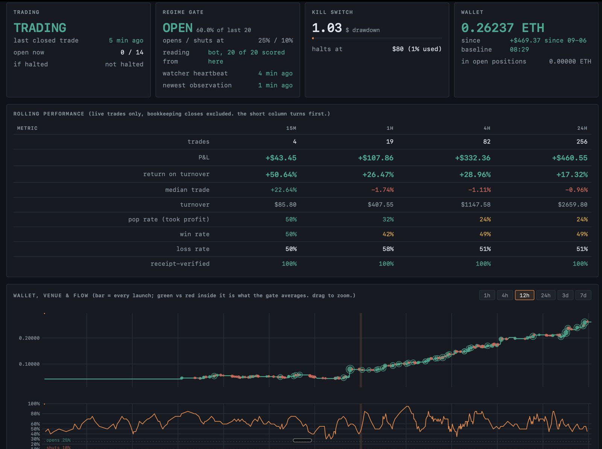

# Snipe

**A retired trading bot, and the research that changed how I built it.**

I built Snipe to trade newly launched tokens on Pons, a bonding-curve venue on Robinhood Chain. V1 connected a strategy to real execution. V2 made decisions reproducible from a recorded event tape. The project ran with real funds and was retired on 25 October 2026.

The repository preserves the profitable periods, losses, failed hypotheses, interface changes, and execution bugs. It does not claim a durable trading edge. Some historical simulations failed their own accuracy checks.



*User-supplied historical live capture. The exact capture time is unknown. The screen shows +$469.37 since its baseline and +$460.55 over 256 trades in 24 hours. These are historical displayed figures, not a recomputed lifetime result.*

## Read the experiment

- [The V1-to-V2 story](docs/story.md): the hypothesis, live feedback, rewrite, and retirement.
- [Results and their limits](results/performance.md): accounting definitions, saved ledgers, and the losing periods.
- [Research index](research/README.md): dated protocols, findings, negative results, and availability.
- [Architecture](docs/architecture.md): why the event tape, clock, driver, and projections are separate.
- [Interface and screenshot gallery](docs/interface.md): how the dashboard evolved.
- [Incidents](docs/incidents/README.md): execution failures and recovery lessons.
- [Dataset availability](datasets/README.md): what can be reproduced from this clone.

## Try the historical dashboard

The [demo](demo/index.html) uses bundled sanitized data and the V2 renderer. It has no wallet or trading connection. It supports book selection, chart windows, tooltips, and expandable trade rows. Missing observer data stays unavailable.

Use Node 22 or later and Python 3.11 or later:

```sh
npm run setup
npm run demo:build
npm run demo
```

Open http://127.0.0.1:8799/demo/. The checked-in demo can be served by any static HTTP server; it needs no application backend. The default view ends on 19 September 2026. A separate view shows the final retirement capture. Neither view is live.

## Repository map

| Directory | Contents |
|---|---|
| `v1/` | Original bot, tests, operational tools, and its research implementation |
| `v2/` | Retired event-driven engine, projections, tests, and replay tools |
| `research/` | Public research index and retained August acquisition/validation tools |
| `docs/` | Narrative, architecture, interface history, incidents, and retirement |
| `results/` | Rebuilt tables, figures, accounting definitions, and historical findings |
| `datasets/` | Sanitized ledger exports, hashes, and availability records |
| `demo/` | Static read-only historical dashboard |
| `assets/` | Selected original captures and new demo screenshots |

Research code remains under `v1/research/` where its relative imports expect it. The public research index is the entry point. Retained dated documents describe their own historical era, even when they use the word “current.”

## Validate

```sh
npm test
npm run typecheck
npm run results:build
npm run check:publication
cd v1
PYTHONPATH=.:research RESEARCH_ALLOW_PAID=0 python3 -m unittest discover -s research -p 'test_*.py'
```

Some research commands need optional Python packages or unavailable frozen inputs. [Verification](docs/verification.md) records the checks actually run. Live-chain curve validation is a separate network check and is not part of the default offline demo.

The example environment files contain no credentials. Running either historical trading entry point requires explicit configuration. The demo requires none.

## Provenance and license

The public source was assembled from the final retired V2 source and the surviving V1/research tree. [Source reconciliation](docs/source-reconciliation.md) separates verified deployed source from later support material. Public history starts with this sanitized edition; the original development history remains privately preserved.

Original project code is licensed under [ISC](LICENSE). Bundled third-party code retains its own license; see [third-party notices](THIRD_PARTY_NOTICES.md).
