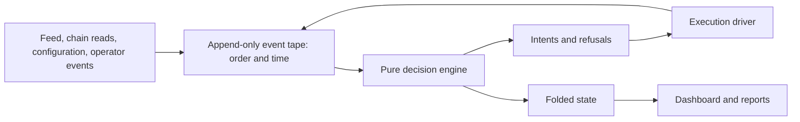

# Why V2 records the decision inputs

V2 separates evidence, decisions, execution, and display. The [original architecture](../v2/docs/architecture.md) contains the detailed diagrams checked by the source tests.

| V1 difficulty | V2 design | Limit |
|---|---|---|
| Live feed evidence was absent from replay | Record the feed overlay on the event tape | A surviving tape is still required for full replay |
| Several code paths consulted time | Assign event time at the appender | Recorded arrival order may still differ from chain inclusion |
| Dashboard calculations could diverge from decisions | Project recorded state through a separate display model | Presentation tests do not prove execution correctness |
| Send, fill, and receipt were easy to confuse | Separate intents, driver effects, and proved settlement | Ambiguous provider responses require recovery |
| Gas could escape position accounting | Track proved gas beside the realized ledger | Missing receipts remain an evidence gap |
| Policies shared implicit rules | Declare complete policies per book | Historical changes require their own provenance |

The public demo imports the projection layer only. It does not import the live driver, signer, sender, environment reader, or chain client. Its build reconstructs display history from sanitized closed-position records. That is a display reconstruction, not replaying the original decision tape.
