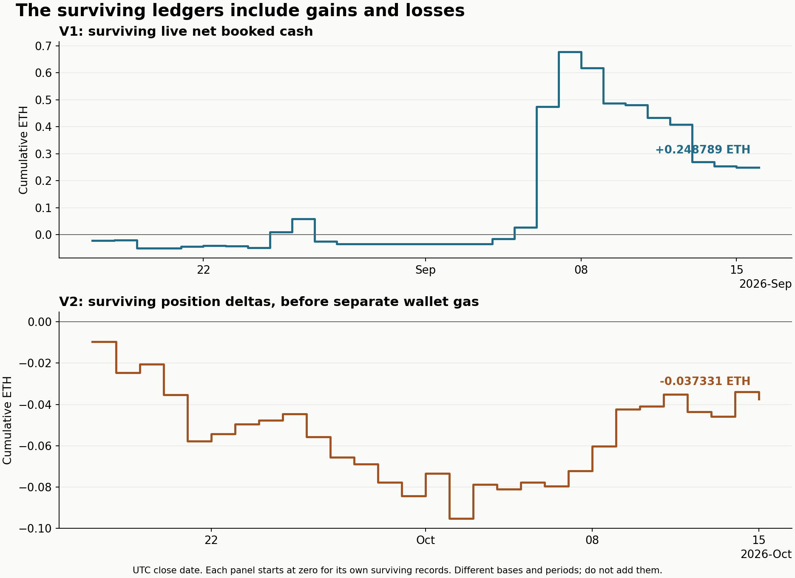

# Historical results and their limits

The surviving ledgers contain profitable periods and losses. They do not establish lifetime wallet profit or a durable trading edge.

## Rebuilt from the retirement export

| Measure | Records | Recorded result | Basis |
|---|---:|---:|---|
| V1 live closed ledger | 2,551 | +0.248788949749620711 ETH | Net booked cash, using recorded on-chain P&L when available |
| V2 saved closed positions | 1,693 | -0.037331048463491416 ETH | Stored position deltas, excluding separately booked wallet gas |
| Final wallet balance | One captured reading | 0.125516224616319761 ETH | Chain balance at retirement, not trading profit |

These cover different periods and accounting bases. Do not add the V1 and V2 figures. The V2 recorded risk ledger contains an accounting epoch that differs from the sum of surviving positions. Its final wallet-realized value was 0.017543723220325624 ETH with 0.001734707249788000 ETH of separately recorded gas. These are epoch values, not a lifetime reconciliation.

All 1,693 V2 position records were closed. Five record abandonment. The legacy export also contains 128 non-live rows, which are excluded from the V1 live cash table. No V1 live row lacks recorded cash or a close timestamp.

The [machine-readable summary](tables/ledger-summary.json) reports mean, median, sample standard deviation, wins, losses, zeros, and count. The [UTC daily table](tables/daily-ledger.csv) exposes the changing periods rather than reducing them to one headline.

## The earlier matched study

The preserved September 13 [error profile](../v1/research/SIMULATION_ERROR_PROFILE_20260913.md) reports:

| Matched period | Attempts | Actual net cash | Reference simulated net |
|---|---:|---:|---:|
| September 4–7 | 900 | +0.551015 ETH | +0.449216 ETH |
| September 8–13 | 282 | -0.408750 ETH | -0.394811 ETH |
| Combined matched sample | 1,182 | +0.142265 ETH | +0.054405 ETH |

Eight unreconciled labels were excluded from the matched comparison. The profile's all-recorded net was +0.304040 ETH. That is a different denominator. These are the original study's frozen figures; this publication did not rerun its unavailable full input set.

The simulator failed the recorded accuracy limits. Similar aggregate returns did not validate trade selection, fills, timing, or tail losses.

## Screenshots

The [early live capture](../assets/screenshots/v1-early-live.png) shows +$469.37 since its baseline and +$460.55 over 256 trades in 24 hours. Its exact capture time is unknown.

The [compact preview](../assets/screenshots/v1-compact-preview.png) shows +$910.45 in its 24-hour column. It is preserved as a historical preview, not a new audited performance claim.

The remembered $1,700 profit screenshot was not located in the inspected repo images, local release images, or surviving worktree variants. No replacement claim or fabricated screenshot is included.

## Reproduce the public tables

Run `npm run results:build` from the repository root. To regenerate the new ledger chart, install the optional packages in `requirements-analysis.txt`, then run `python3 scripts/build-figures.py`.

The [methodology](methodology.md) defines each accounting basis and the public identity omissions. The public exports were compared numerically with the private originals. They cannot be independently linked to receipts because direct wallet and transaction identifiers are omitted.
