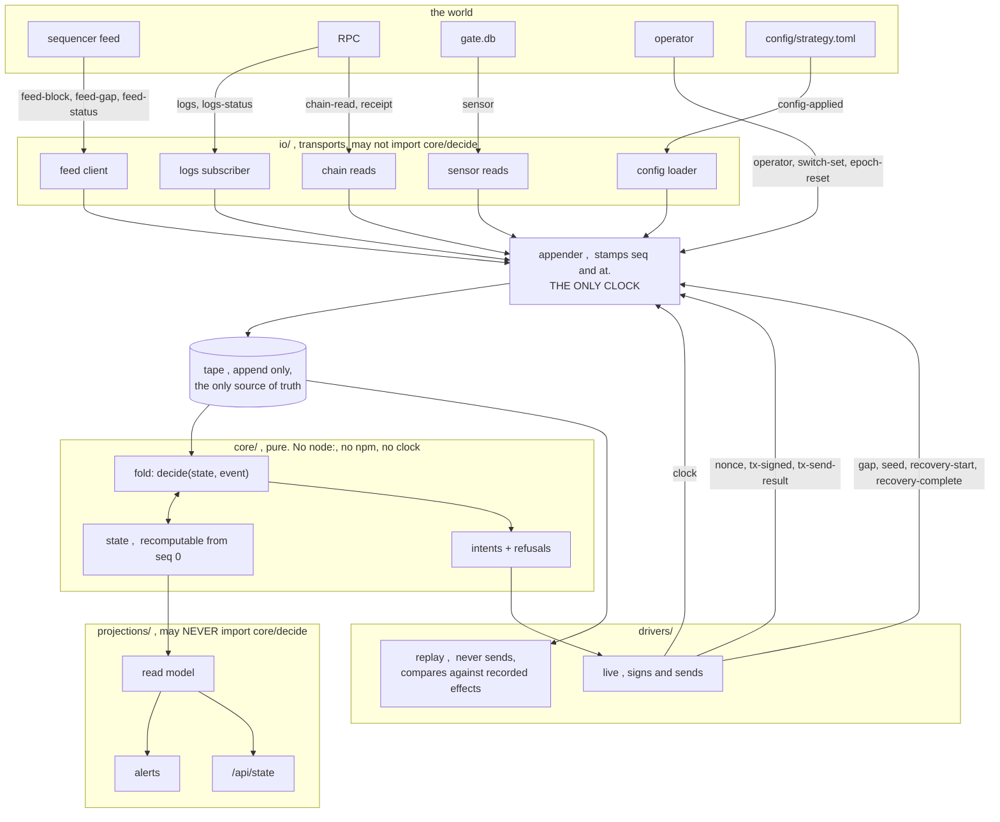
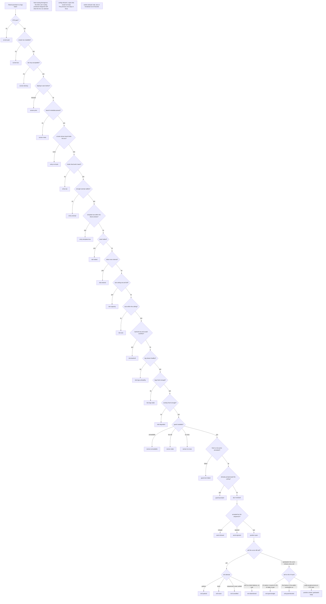

# How the bot is put together

Two diagrams. Both are checked by `test/diagrams.test.ts`, which fails when an event kind or a
refusal bucket exists in code and not here, or here and not in code. A diagram nothing checks
is a diagram that is wrong within a week, and this repo has already paid for that lesson: the
old `CLAUDE.md` said "no silent killers" in the same week a silent killer stopped the
measurement pipeline, and `levels.ts` opened with "a threshold lives here" while nineteen of
its twenty thresholds sat inline somewhere else.

## 1. Events in, intents out

Everything the bot knows is a fold over one append-only tape. The transports do not decide
anything, the core decides everything and touches nothing, and the drivers are the only code
that can act on the world.

Three things the picture is making a claim about.

**The feed is on the tape.** Every entry price and every exit mark is computed from confirmed
logs *plus* the unconfirmed feed overlay. In the old bot the feed was recorded nowhere, so a
replay could not reproduce a live decision and the existing replay quietly sidestepped it by
rebuilding from `eth_getLogs` instead. That made it an independent second opinion rather than
a reproduction, which is the real reason the paper account matched none of 49 real trades.

**The clock is one arrow.** `appender` stamps `at`, and nothing downstream reads a clock.
Every time rule reads `event.at`.

**Projections point away from core.** They may read `state`, never `decide`. That import ban
is what kills the eleven cases where the old dashboard re-derived a decision the bot had
already made, including replaying the regime gate on every poll and discarding the answer.

## 2. What refuses a trade, and in what order

Read top to bottom. The first refusal wins and nothing below it runs, which is what makes the
funnel's denominators mean anything. Every box is a bucket in `RefusalBucket`, counted, and a
bucket that becomes the whole of a trailing window is an alert.

The last three sit apart because they are not part of a launch's journey. They are refusals of
an input rather than of a trade.

**The two exit paths are two venues, not two outcomes.** A curve refuses every sell the moment
its sellable supply hits zero, so a bag still held at that point has not failed to exit: it has
changed market, and the tokens are reachable only through the graduated V4 pool. `graduationExitAt`
exists to leave before that happens and mostly does; when it does not, the position flips venue
and the right-hand path sells it there. v2 parked those bags instead, which is why the path is
drawn: three positions would have sat open forever, showing as healthy on every projection. The
two refusals on it are both "a person has to look" ,  a spend ceiling reached, or the factory and
the wallet disagreeing with what we believe we hold.

**Why the order is this order.** The screen comes first because it defines the observation
universe every sensor measures on, and it must run on launches the bot will never buy or the
gate would only ever see its own choices. Capacity is claimed before any `await`, so two
launches arriving in one batch cannot both take the last slot. The graduation guard runs last
because it costs two curve simulations and there is no point paying for them on a launch that
eight cheaper checks would have refused.
